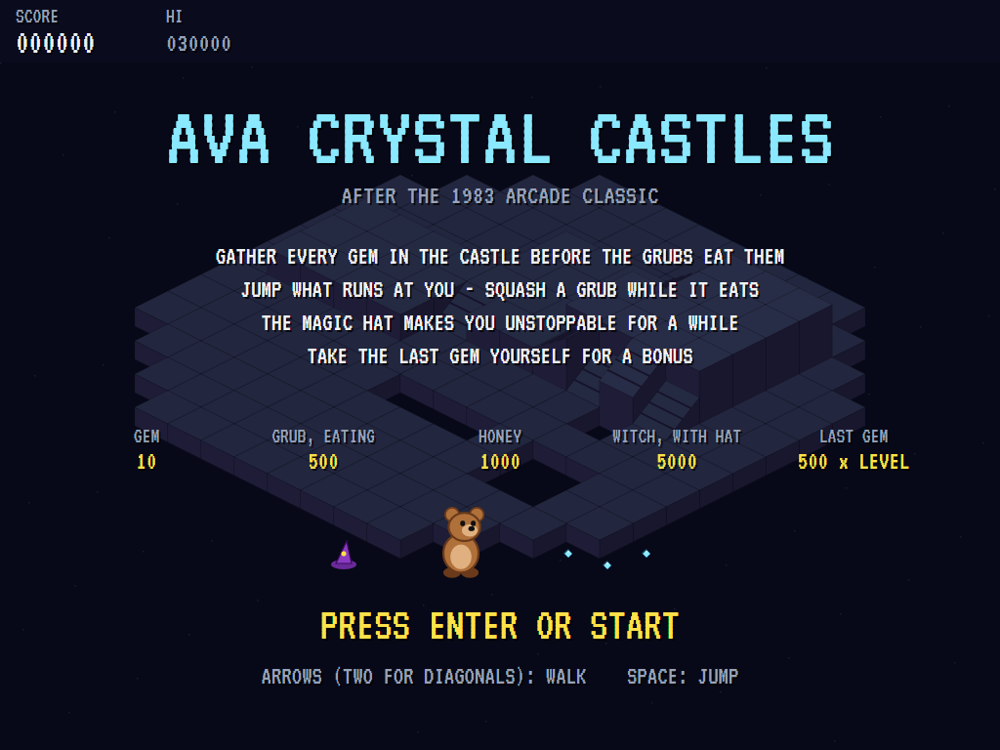
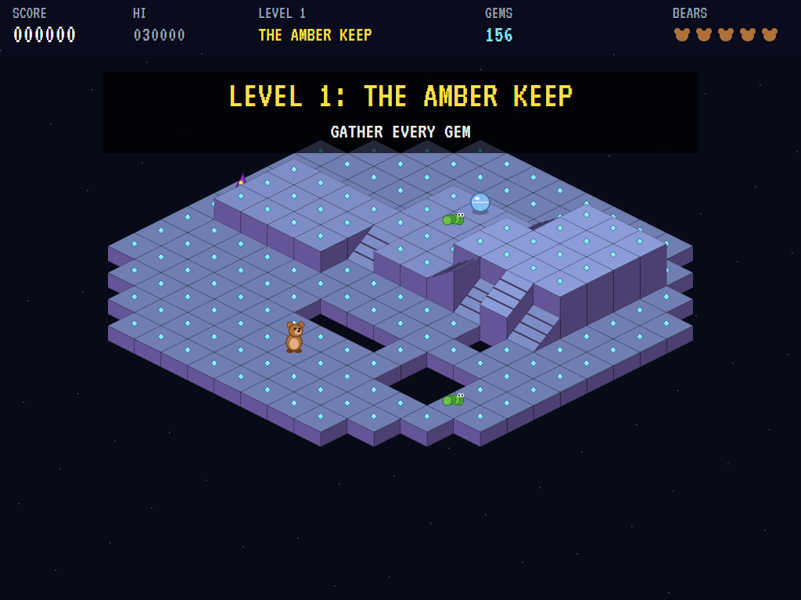
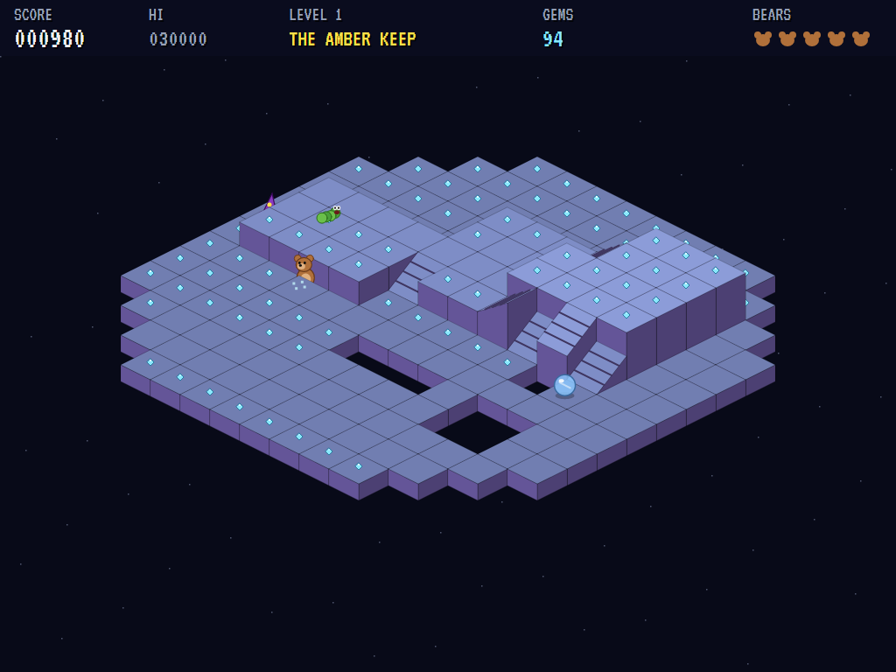
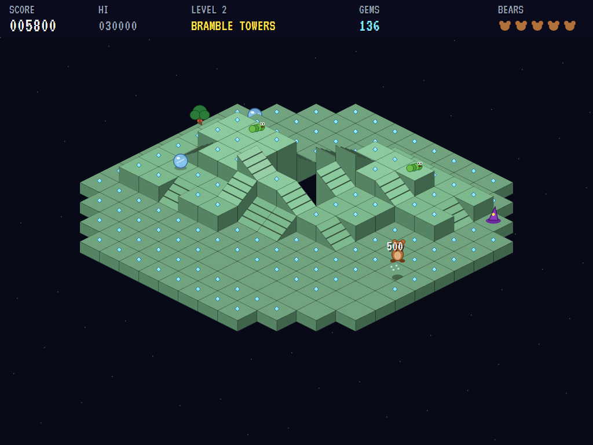
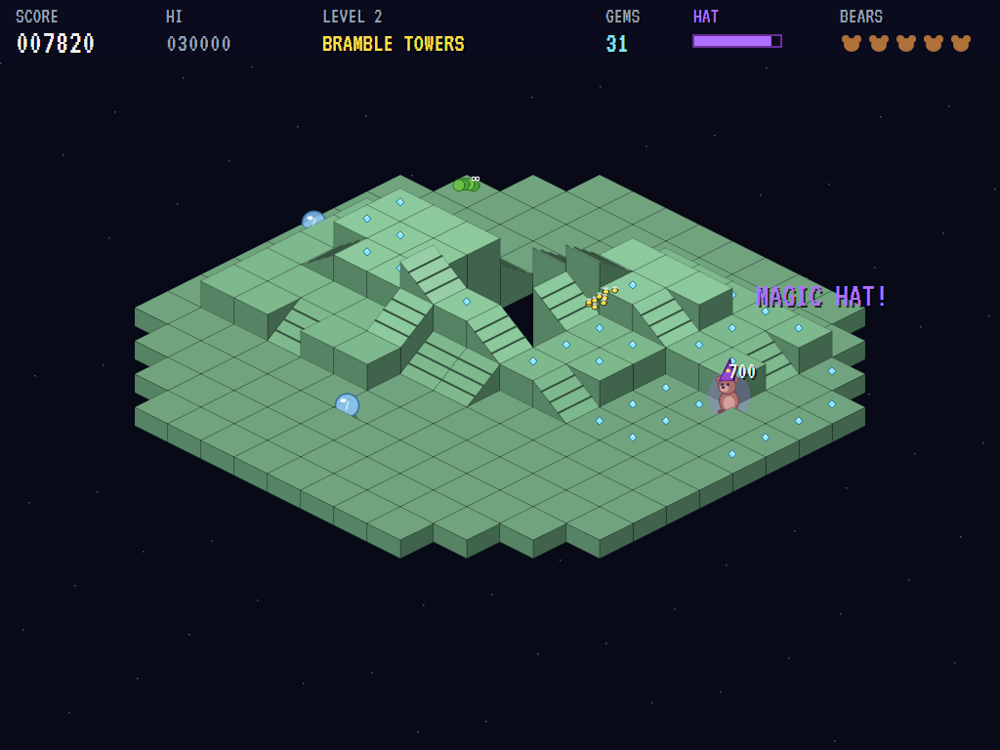
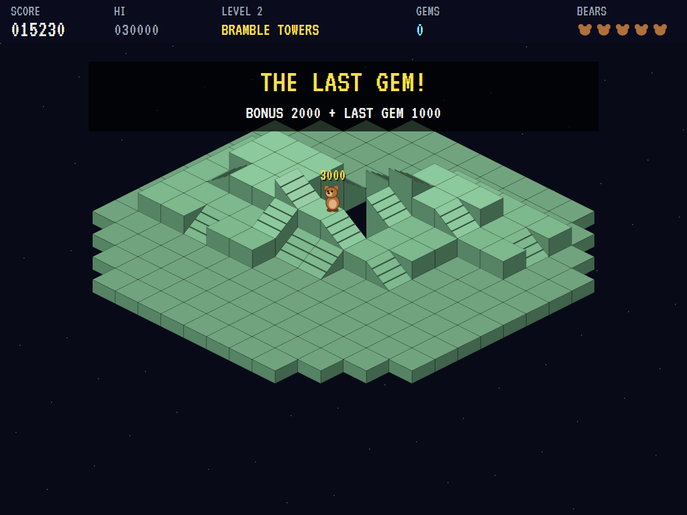
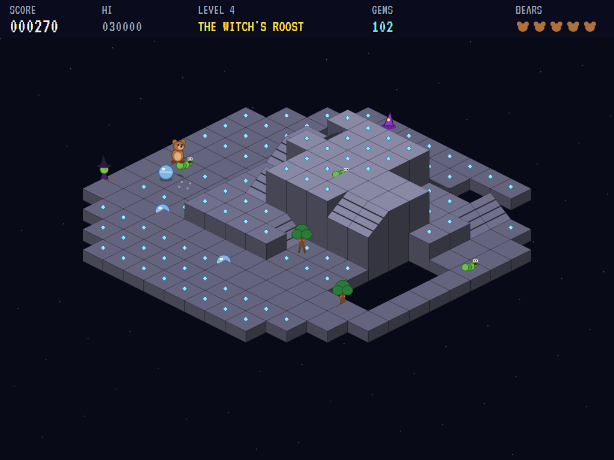
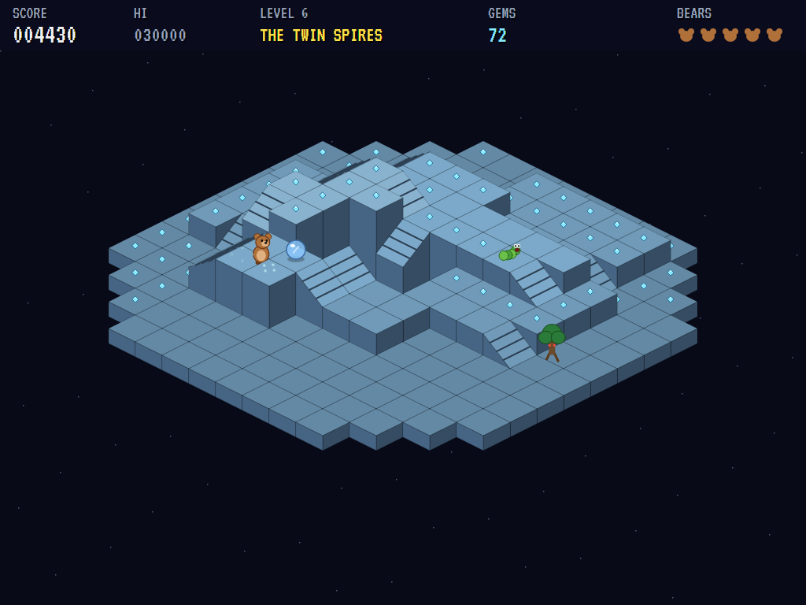
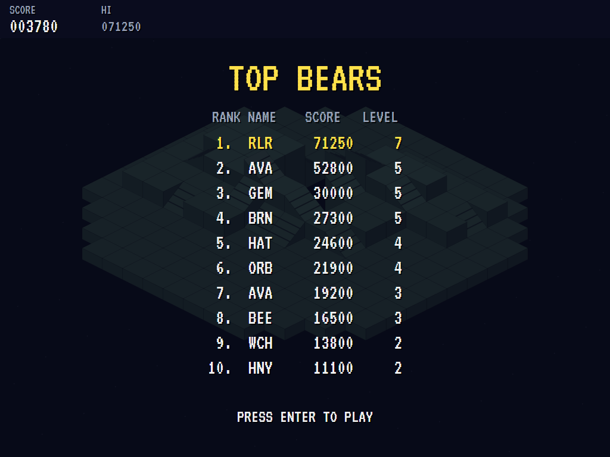

# AVA Crystal Castles

[](https://github.com/Harlock123/AVACrystalCastles/actions/workflows/build.yml)

A gem-gathering chase in the style of Atari's 1983 arcade game **Crystal Castles**, built with .NET 10 and
Avalonia UI. A bear wanders isometric castles of raised walkways, stairs and pits, gathering every gem
before the grubs eat them. Jump the orbs and walking trees that come for it, run from the bees, and put on
the magic hat to turn the tables.

## Features

- **Isometric castles**:
  - **The layout:** walkways at up to four heights, joined by stairs, with walls between the heights and pits in the floors.
  - **Building them:** each castle is built from its level number, so a level is the same castle every time. Every walkway square can be reached, and almost every one holds a gem.
- **The bear**:
  - **Walking:** it walks eight ways, the diagonals running straight along the walkways. Up and down stairs it goes, but never through a wall or off the side of a stair.
  - **Jumping:** it can jump over anything that rolls or walks into it.
- **The enemies**:
  - **Gem grubs** crawl to the nearest gem and eat it. They can only be squashed while they're chewing.
  - **Rolling orbs** chase the bear along the walkways.
  - **Thorn trees** walk after it more slowly, from the second castle on.
  - **The bees** swarm out partway through every castle, fly straight at the bear over everything, and can't be jumped.
  - **The witch** haunts every fourth castle.
- **The magic hat**: one per castle. Wear it and nothing can hurt the bear for a few seconds, and it squashes whatever it touches, bees and witch included.
- **Honey**: a honey pot appears for a while in each castle, worth 1,000.
- **Clearing a castle**: gather (or lose to the grubs) every gem for a bonus of 1,000 times the level. Take the last gem yourself for another 500 times the level. Castles get faster as you go.
- **Scoring**:
  - Gems 10, honey 1,000, the last gem 500 times the level
  - A grub squashed while eating 500
  - With the hat: orbs 300, trees 700, the bees 3,000, the witch 5,000
  - An extra bear at 25,000 points and every 50,000 after that
- **Sound**: a twinkling waltz in E minor, with the gem chime, jumps and landings, squashes, munching grubs, the hat's rising and falling scale, the bees' buzz, the witch's cackle and the last-gem fanfare. All of it is synthesised and mixed by OpenAL.
- **Attract mode**: leave the title alone for 15 seconds and a computer bear plays. It walks to the nearest gem, jumps what comes at it, squashes grubs while they eat, runs from the bees, fetches the hat when things get close, and grabs the honey.
- **A top-ten high-score table** with arcade-style initials entry. It records the level reached.
- **Gamepads** through SDL2, as well as the keyboard.
- **Any window size**: the screen scales to fit, letterboxed. **Ctrl+S** saves a screenshot.
- **One self-contained executable** per platform: Windows, macOS and Linux on Intel/AMD and ARM.

## Screenshots

| The title | The Amber Keep | Gathering |
|:---------:|:--------------:|:---------:|
|  |  |  |
| What everything is worth. | The first castle. | Gems on every walkway. |

| A jump | A grub eating | The bees |
|:------:|:-------------:|:--------:|
|  |  |  |
| Over what rolls at it. | Squash it now. | Run! |

| The magic hat | Cleared | The Witch's Roost |
|:-------------:|:-------:|:-----------------:|
|  |  |  |
| Nothing can touch it. | The last gem. | Every fourth castle. |

| The Twin Spires | The best bears | |
|:---------------:|:--------------:|:-:|
|  |  | |
| Stairs on stairs. | The high-score table. | |

The screenshots are made by the tests, which play the game in a real (headless) window; see
[Tests](#tests).

## Download and run

Ready-to-run builds for Windows, macOS and Linux, on both Intel/AMD and ARM, are on the
[Releases page](https://github.com/Harlock123/AVACrystalCastles/releases/tag/latest). **Latest build** is
rebuilt on every push to `main`. Each download is one self-contained executable: no .NET install is
needed.

| Platform | Archive |
|---|---|
| Windows | `AVACrystalCastles-win-x64.zip`, `AVACrystalCastles-win-x86.zip`, `AVACrystalCastles-win-arm64.zip` |
| macOS | `AVACrystalCastles-osx-arm64.tar.gz` (Apple silicon), `AVACrystalCastles-osx-x64.tar.gz` (Intel) |
| Linux | `AVACrystalCastles-linux-x64.tar.gz`, `AVACrystalCastles-linux-arm64.tar.gz`, `AVACrystalCastles-linux-arm.tar.gz` |

```bash
tar -xzf AVACrystalCastles-linux-x64.tar.gz     # or linux-arm64, linux-arm, osx-arm64, osx-x64
./AVACrystalCastles
```

On Windows, unzip and run `AVACrystalCastles.exe`. On macOS, if Gatekeeper refuses to open it, run
`xattr -d com.apple.quarantine AVACrystalCastles` once. Run with `--no-audio` for silence.

**Sound** comes through OpenAL Soft, built in for every platform. In a virtual machine the game
detects it and uses a larger audio buffer, so the sound doesn't break up.

**Gamepads** use SDL2, which is bundled for Windows, macOS and Intel/AMD Linux. ARM Linux builds need it
installed; without it the keyboard still works:

```bash
sudo apt install libsdl2-dev            # Debian / Ubuntu / Raspberry Pi OS
sudo pacman -S --needed sdl2-compat     # Arch / Omarchy
```

## Controls

| Input | Action |
|-------|--------|
| **Enter** | Start |
| **Arrow keys** / **W A S D**, two at once for the diagonals (or the numeric keypad) | Walk: the diagonals run along the walkways |
| **Space** / **Z** / **X** / **Ctrl** | Jump |
| **P** / **Esc** | Pause (Esc again to quit) |
| **M** | Mute |
| **Ctrl+S** / **Cmd+S** | Save a screenshot to the Pictures folder |

**Gamepad**: left stick or D-pad to walk, **A**, **B** or **X** to jump, **Start** to start and pause,
**Back** (while paused) to quit.

**Entering initials**: type letters, or dial with **Up**/**Down** and accept with **Space**; **Left** /
**Backspace** go back; **Enter** finishes.

## Tests

```bash
dotnet test AVACrystalCastles.slnx
```

The engine has no UI and runs in fixed 60 Hz steps, so it plays the same at any frame rate, and a seed
always plays the same game. The tests check:

- **The castles:**
  - every square of every castle reachable, with gems on the walkways and none on stairs
  - more than one height, and the same castle from the same level
  - stairs joining heights, and walls and the sides of stairs that can't be crossed
- **The bear:** walking the way the stick points and gathering gems, walls stopping it, and jumping
- **Enemies:**
  - an orb chasing it down, and a jump carrying it over one
  - a grub eating a gem, squashed only while it eats, and catching the bear otherwise
  - the magic hat squashing anything until it wears off
  - the bees that a jump won't dodge, and the honey
- **Castles and bears:**
  - the last gem's bonus and the next castle
  - the witch on every fourth
  - a lost bear starting again, and the last one ending the game
- **The machine:** the computer bear clearing the first castle, the attract cycle, the same game from the same seed, initials and the high-score file

The screenshot tests draw the real screen in a headless window. To refresh the README's pictures:

```bash
CASTLES_SHOTS=$PWD/Images dotnet test tests/AVACrystalCastles.Tests --filter ScreenshotTests
```

To see the castles and how the computer bear gets on, castle by castle (for tuning):

```bash
CASTLES_PROBE=1 dotnet test tests/AVACrystalCastles.Tests --filter PilotProbe --logger "console;verbosity=detailed"
```

## Building

```bash
dotnet build AVACrystalCastles.slnx
dotnet run --project src/AVACrystalCastles
```

Needs the .NET 10 SDK. The sounds are made by `tools/make_sounds.py` (standard-library Python):
`python3 tools/make_sounds.py` rewrites `src/AVACrystalCastles/Sounds`.

## Project structure

```
AVACrystalCastles/
├── AVACrystalCastles.slnx
├── src/AVACrystalCastles/
│   ├── Engine/
│   │   ├── GameEngine.cs        # States, the title and demo cycle, and the music
│   │   ├── GameEngine.Play.cs   # The bear, jumping and gathering, the grubs, orbs, trees, bees and witch,
│   │   │                        # the hat, honey, castles and scoring
│   │   ├── Castle.cs            # Building each castle: heights, stairs, pits, gems; walking and paths
│   │   ├── BearPilot.cs         # The computer bear, for the demonstration (and the tests)
│   │   ├── Entities.cs
│   │   ├── HighScoreTable.cs, InitialsEntry.cs
│   │   ├── InputHandler.cs, ControllerManager.cs  # Keys and an SDL2 gamepad
│   │   └── SoundManager.cs      # Effects, the waltz and the jingles through OpenAL
│   ├── Audio/                   # The OpenAL engine (from the author's AVABand)
│   ├── Views/                   # The castle in isometric blocks, the bear and its enemies, and the screens
│   └── Sounds/                  # The synthesised effects and tunes
├── tests/AVACrystalCastles.Tests/ # Gameplay, screenshot and probe tests
├── tools/make_sounds.py
└── Images/                      # Screenshots
```

## About and licence

AVA Crystal Castles © 2026 Lonnie Watson, under the [MIT License](LICENSE).

*Crystal Castles* © 1983 Atari; the name belongs to its current owner. AVA Crystal Castles is an
independent, unofficial game in its style. Its bear, its enemies, its castles and their names, graphics,
sounds, tunes and code are its own; nothing is taken from the arcade machine's program, graphics, sound
or music. It is not affiliated with or endorsed by any rights holder.
